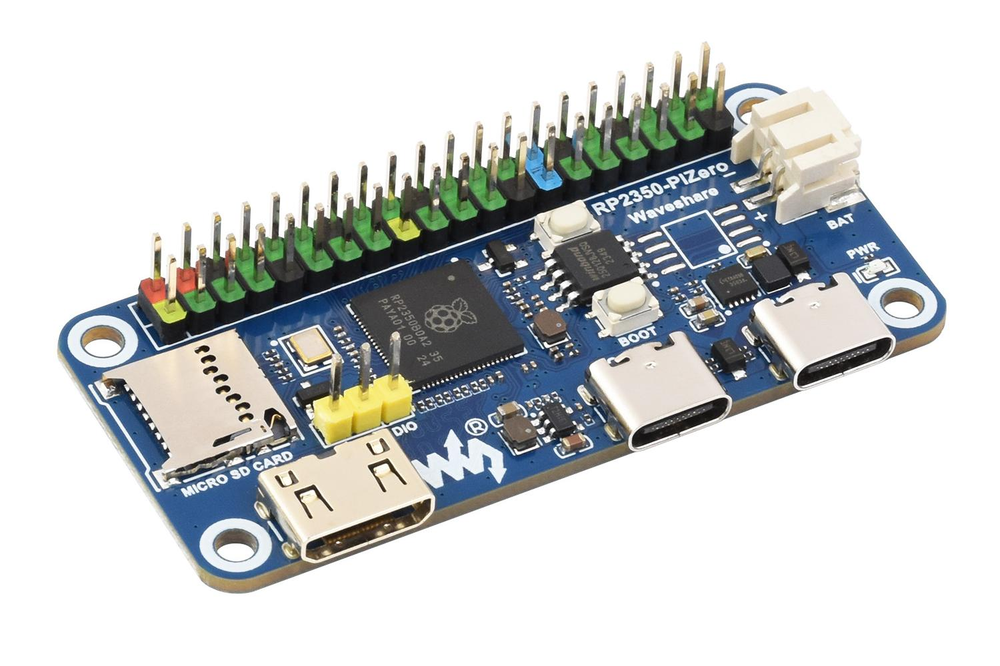
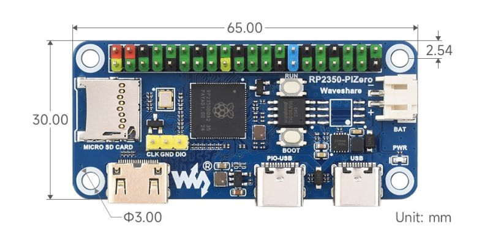
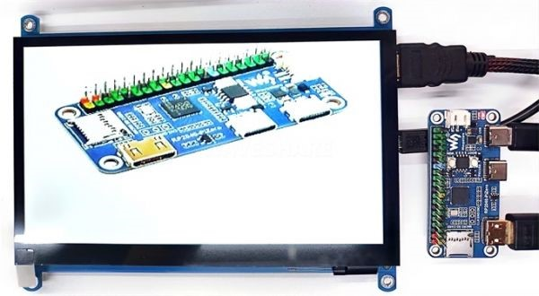
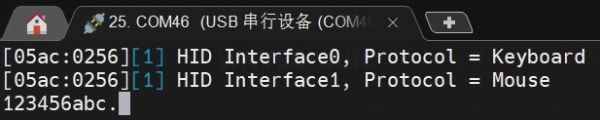

# Waveshare RP2350-PiZero

Carte de développement basée sur le microcontrôleur **Raspberry Pi RP2350B** au format Raspberry Pi Zero (`65 × 30 mm`), dotée d'une sortie vidéo **Mini-HDMI / DVI**, d'un lecteur **MicroSD (TF)**, de deux ports **USB Type-C** (USB natif + **PIO-USB** Host/Device) et d'un connecteur **GPIO 40 broches**.



---

## Liens officiels & Documentation

- **Page Wiki officielle Waveshare** : <https://www.waveshare.com/wiki/RP2350-PiZero>
- **Schéma structurel (PDF)** : <https://files.waveshare.com/wiki/RP2350-PiZero/RP2350-PiZero.pdf>
- **Plan d'implantation des composants (PDF)** : <https://files.waveshare.com/wiki/RP2350-PiZero/RP2350-PiZero-Pos.pdf>
- **Datasheet RP2350 (Raspberry Pi)** : <https://files.waveshare.com/wiki/common/Rp2350-datasheet.pdf>

---

## Caractéristiques du module

- **Microcontrôleur** : Raspberry Pi **RP2350B** (boîtier QFN-80)
  - Architecture double cœur et double jeu d'instructions : **2× ARM Cortex-M33** ou **2× Hazard3 RISC-V** (commutation possible), fréquence nominale jusqu'à **150 MHz** (supporte l'overclocking ex. `252 MHz` pour le DVI).
- **Mémoires** :
  - **520 Ko de SRAM** interne
  - **16 Mo de Flash QSPI** intégrée sur la carte
  - **Emplacement PSRAM** (pad soudable / 8 Mo APS6404L sur `CS1 = GPIO 47`)
- **Connectique & Interfaces intégrées** :
  - **Port Mini-HDMI / DVI** intégré (pilotable via PIO pour piloter des écrans HDMI/DVI)
  - **Port USB Type-C (`USB`)** : USB 1.1 natif (Device / Host, programmation glisser-déposer `.uf2` en mode `BOOT`)
  - **Port USB Type-C (`PIO-USB`)** : interface USB Host ou Device via PIO (`GPIO 28` / `GPIO 29`)
  - **Lecteur de carte MicroSD (TF)** intégré (SPI1 matériel)
  - **Connecteur batterie Lithium** (charge / décharge sur embase 2 broches `BAT`)
  - **Connecteur 40 broches GPIO** compatible Raspberry Pi (expose **28 GPIO multifonctions**)
  - **Embase Debug SWD** 3 broches (`CLK`, `GND`, `DIO`)
  - Boutons **BOOT** et **RUN** (Reset), LED **PWR**
- **Périphériques internes du RP2350B** :
  - `12 ×` machines à états **PIO** programmables (`3` blocs PIO × 4 SM)
  - `1 ×` interface **HSTX**
  - `2 ×` SPI, `2 ×` I2C, `2 ×` UART, `16 ×` canaux PWM
  - Capteur de température interne, horloge/timers précis, accélération virgule flottante



---

## Tableau des GPIO sur le connecteur externe (40 broches)

Le connecteur externe reprend le brochage standard Raspberry Pi à **2 rangées × 20 broches** (vu de dessus, broche 1 en haut à gauche) :

| Broche | Signal / Fonction | GPIO | | GPIO | Signal / Fonction | Broche |
| :---: | :--- | :---: | :---: | :---: | :--- | :---: |
| **1** | Alimentation **3.3V** | — | | — | Alimentation **5V** | **2** |
| **3** | I2C1 `SDA` | **GPIO 2** | | — | Alimentation **5V** | **4** |
| **5** | I2C1 `SCL` | **GPIO 3** | | — | Masse (**GND**) | **6** |
| **7** | `GPCLK0` / I2C0 `SDA` | **GPIO 4** | | **GPIO 14** | UART0 `TX` / SPI1 `SCK` | **8** |
| **9** | Masse (**GND**) | — | | **GPIO 15** | UART0 `RX` / SPI1 `MOSI` | **10** |
| **11** | SPI0 `CS` | **GPIO 17** | | **GPIO 18** | SPI0 `SCK` / I2S | **12** |
| **13** | I2C1 `SCL` / ADC1 | **GPIO 27** | | — | Masse (**GND**) | **14** |
| **15** | GPIO | **GPIO 22** | | **GPIO 23** | GPIO | **16** |
| **17** | Alimentation **3.3V** | — | | **GPIO 24** | GPIO | **18** |
| **19** | GPIO / SPI1 | **GPIO 10** | | — | Masse (**GND**) | **20** |
| **21** | UART1 `RX` | **GPIO 9** | | **GPIO 25** | GPIO | **22** |
| **23** | GPIO | **GPIO 11** | | **GPIO 8** | UART1 `TX` | **24** |
| **25** | Masse (**GND**) | — | | **GPIO 7** | GPIO | **26** |
| **27** | UART0 `TX` | **GPIO 0** | | **GPIO 1** | UART0 `RX` | **28** |
| **29** | I2C0 `SCL` | **GPIO 5** | | — | Masse (**GND**) | **30** |
| **31** | GPIO | **GPIO 6** | | **GPIO 12** | SPI1 `MISO` | **32** |
| **33** | SPI1 `CS` | **GPIO 13** | | — | Masse (**GND**) | **34** |
| **35** | SPI0 `MOSI` | **GPIO 19** | | **GPIO 16** | SPI0 `MISO` | **36** |
| **37** | **ADC0** / I2C1 `SDA` | **GPIO 26** | | **GPIO 20** | GPIO | **38** |
| **39** | Masse (**GND**) | — | | **GPIO 21** | GPIO | **40** |

> *Note : Les GPIO `0` à `27` (28 broches) sont entièrement disponibles en 3.3V sur le header 40 broches (ne jamais appliquer 5V sur une broche GPIO).*

### Broches réservées en interne sur la carte

| Interface intégrée | GPIO utilisés | Notes |
| :--- | :--- | :--- |
| **Mini-HDMI / DVI** | `GPIO 32` à `GPIO 39` | `D2` (`32/33`), `D1` (`34/35`), `D0` (`36/37`), `CLK` (`38/39`) |
| **PIO-USB (Type-C)** | `GPIO 28` (`D+`), `GPIO 29` (`D-`) | Port USB Host/Device secondaire |
| **MicroSD (TF)** | `GPIO 30` (`SCK`), `GPIO 31` (`MOSI`), `GPIO 40` (`MISO`), `GPIO 43` (`CS`) | Bus SPI1 interne |
| **PSRAM (`CS1`)** | `GPIO 47` | Chip Select QMI M1 |

| Sortie DVI (640×480p @ 60 Hz) | Port PIO-USB Host |
| :---: | :---: |
|  |  |

---

## Utilisation de base avec PlatformIO (Arduino / Earle Philhower)

### 1. Configuration `platformio.ini`

Créez un projet PlatformIO avec la configuration suivante à la racine (`platformio.ini`) :

```ini
[env:waveshare_rp2350_pizero]
platform = https://github.com/maxgerhardt/platform-raspberrypi.git
board = waveshare_rp2350_pizero
framework = arduino
board_build.core = earlephilhower

; Optionnel : fréquence CPU (150 MHz par défaut, ou 252000000L pour DVI)
; board_build.f_cpu = 150000000L

monitor_speed = 115200
```

### 2. Exemple minimal (`src/main.cpp`)

```cpp
#include <Arduino.h>

#define LED_PIN 25  // Exemple sur GPIO 25 (broche 22 du header)

void setup() {
    Serial.begin(115200);
    pinMode(LED_PIN, OUTPUT);
    delay(1000);
    Serial.println("Waveshare RP2350-PiZero pret !");
}

void loop() {
    digitalWrite(LED_PIN, HIGH);
    Serial.println("LED ON");
    delay(500);

    digitalWrite(LED_PIN, LOW);
    Serial.println("LED OFF");
    delay(500);
}
```

### 3. Compilation et flashage (`.uf2`)

1. **Compiler** le projet :
   ```bash
   pio run
   ```
   Le binaire prêt à flasher est généré dans `.pio/build/waveshare_rp2350_pizero/firmware.uf2`.
2. **Passer la carte en mode BOOTSEL** :
   - Maintenez le bouton **`BOOT`** enfoncé pendant que vous branchez le câble USB-C sur le port **`USB`** (le plus à droite).
   - *(Ou carte déjà alimentée : maintenez `BOOT`, appuyez brièvement sur `RUN`, puis relâchez `BOOT`)*.
3. Un lecteur amovible nommé **`RP2350`** apparaît sur votre PC.
4. **Glissez-déposez** `firmware.uf2` sur ce lecteur (ou utilisez `pio run -t upload` une fois que le port série CDC est actif). La carte redémarre automatiquement.
