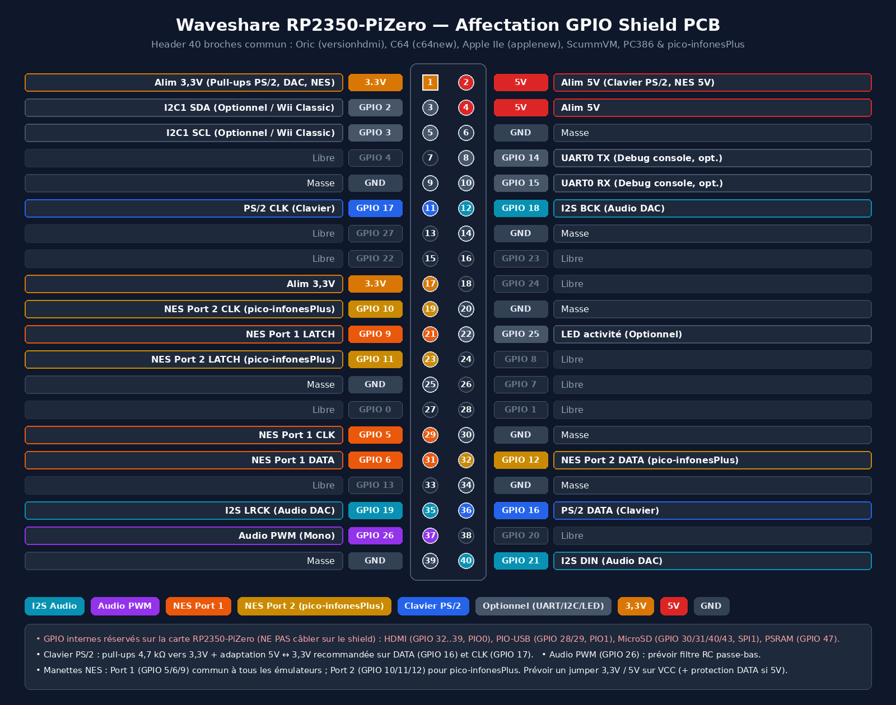

# Brochage GPIO unifié — Shield PCB pour Waveshare RP2350-PiZero

Ce document récapitule l'ensemble des **GPIO utilisés** dans les projets RP2350-PiZero (`versionhdmi` Oric, `c64new`, `applenew`, `scumm`, `pc386`) afin de concevoir un **shield PCB commun** sur le connecteur **40 broches (format Raspberry Pi)** de la carte **Waveshare RP2350-PiZero**.

---

## 1. Connectique à placer sur le Shield (Header 40 broches)

### 1.1 Audio I2S (DAC externe type PCM5102A)
| Signal | GPIO RP2350 | Broche Header 40 pins | Notes PCB |
| :--- | :---: | :---: | :--- |
| **I2S BCK** (Bit Clock) | `GPIO 18` | **12** | Impératif : `LRCK = BCK + 1` (`PIO2`) |
| **I2S LRCK** (Word Select) | `GPIO 19` | **35** | |
| **I2S DIN** (Data RP2350 → DAC) | `GPIO 21` | **40** | |
| **Alimentation DAC** | `3,3V` / `5V` & `GND` | **1** (`3,3V`) ou **2/4** (`5V`), **6/9/14/20/25/30/34/39** (`GND`) | Sur PCM5102A : `SCK` relié à `GND` (PLL interne), `FMT=GND`, `XSMT=3,3V` |

### 1.2 Audio PWM (Sortie analogique mono)
| Signal | GPIO RP2350 | Broche Header 40 pins | Notes PCB |
| :--- | :---: | :---: | :--- |
| **Audio PWM** | `GPIO 26` | **37** | Prévoir un filtre passe-bas RC (ex. `1 kΩ` + `100 nF` + condo de liaison `10 µF`) vers jack 3,5 mm |

### 1.3 Manette NES
| Signal | GPIO RP2350 | Broche Header 40 pins | Notes PCB |
| :--- | :---: | :---: | :--- |
| **NES CLK** | `GPIO 5` | **29** | Sortie RP2350 → Manette |
| **NES DATA** | `GPIO 6` | **31** | Entrée Manette → RP2350 (pull-up interne activé, `10 kΩ` externe conseillé) |
| **NES LATCH** | `GPIO 9` | **21** | Sortie RP2350 → Manette |
| **Alimentation NES** | `3,3V` ou `5V` & `GND` | **1/17** (`3,3V`) ou **2/4** (`5V`), `GND` | `pico-infonesPlus` recommande **`5V`** pour les manettes NES d'origine ; prévoir un **jumper `3,3V / 5V`** sur le PCB (et une résistance série/level-shifter sur `DATA` en mode `5V` pour protéger le `GPIO 6`) |

### 1.3b Manette NES — Port 2 (compatibilité `pico-infonesPlus` 2 joueurs)
| Signal | GPIO RP2350 | Broche Header 40 pins | Notes PCB |
| :--- | :---: | :---: | :--- |
| **NES P2 CLK** | `GPIO 10` | **19** | Libre dans tous les autres projets (`Oric`, `C64`, `Apple`, `Scumm`, `pc386`) |
| **NES P2 LATCH** | `GPIO 11` | **23** | Libre dans tous les autres projets |
| **NES P2 DATA** | `GPIO 12` | **32** | Libre dans tous les autres projets |

### 1.4 Clavier PS/2 (Mini-DIN 6 broches)
| Signal | GPIO RP2350 | Broche Header 40 pins | Notes PCB |
| :--- | :---: | :---: | :--- |
| **PS/2 DATA** | `GPIO 16` | **36** | Impératif : `CLK = DATA + 1` (`PIO2`) |
| **PS/2 CLK** | `GPIO 17` | **11** | |
| **Alimentation & Pull-ups** | `5V` (clavier) / `3,3V` (pull-ups) | **2/4** (`5V`), **1/17** (`3,3V`), `GND` | Pull-ups `4,7 kΩ` vers `3,3V` + adaptation de niveau (`5V ↔ 3,3V` via MOSFET BSS138 ou diodes/résistances de protection) recommandée sur `DATA` et `CLK` car les claviers PS/2 sont alimentés en `5V` |

---

## 2. GPIO optionnels sur le Header 40 broches (Extension / Debug)

| Fonction | GPIO RP2350 | Broche Header 40 pins | Usage |
| :--- | :---: | :---: | :--- |
| **UART0 TX** | `GPIO 14` | **8** | Console série debug (`115200 bauds`) |
| **UART0 RX** | `GPIO 15` | **10** | Console série debug |
| **I2C1 SDA** | `GPIO 2` | **3** | Bus I2C réservé (écrans OLED / extensions) |
| **I2C1 SCL** | `GPIO 3` | **5** | Bus I2C réservé |
| **LED activité** | `GPIO 25` | **22** | LED d'activité disque / K7 (optionnelle) |

---

## 3. GPIO internes réservés sur le PCB Waveshare RP2350-PiZero (NE PAS utiliser sur le shield)

Ces GPIO sont câblés en interne sur la carte Waveshare RP2350-PiZero :

| Périphérique intégré | GPIO RP2350 | Bus / PIO |
| :--- | :---: | :--- |
| **Mini-HDMI / DVI** | `GPIO 32..39` | `PIO0` (`32/33` D2, `34/35` D1, `36/37` D0, `38/39` CLK) |
| **Port Type-C PIO-USB Host** | `GPIO 28` (`D+`), `GPIO 29` (`D-`) | `PIO1` |
| **Lecteur MicroSD** | `GPIO 30` (`SCK`), `GPIO 31` (`MOSI`), `GPIO 40` (`MISO`), `GPIO 43` (`CS`) | `SPI1` |
| **PSRAM QSPI `8 Mo`** | `GPIO 47` (`CS1`) | `QMI CS1` |

---

## 4. Récapitulatif rapide par broche du Header 40 pins

| Broche Header | GPIO | Fonction sur le Shield |
| :---: | :---: | :--- |
| **1** / **17** | — | `+3,3V` (Alim NES, pull-ups PS/2, DAC I2S) |
| **2** / **4** | — | `+5V` (Alim clavier PS/2, alim DAC si régulateur `3,3V` intégré) |
| **6, 9, 14, 20, 25, 30, 34, 39** | — | `GND` |
| **3** | `GPIO 2` | *(Optionnel)* I2C1 SDA |
| **5** | `GPIO 3` | *(Optionnel)* I2C1 SCL |
| **8** | `GPIO 14` | *(Optionnel)* UART0 TX |
| **10** | `GPIO 15` | *(Optionnel)* UART0 RX |
| **11** | `GPIO 17` | **PS/2 CLK** |
| **12** | `GPIO 18` | **I2S BCK** |
| **19** | `GPIO 10` | *(Optionnel `pico-infonesPlus`)* **NES Port 2 CLK** |
| **21** | `GPIO 9` | **NES Port 1 LATCH** |
| **22** | `GPIO 25` | *(Optionnel)* LED activité |
| **23** | `GPIO 11` | *(Optionnel `pico-infonesPlus`)* **NES Port 2 LATCH** |
| **29** | `GPIO 5` | **NES Port 1 CLK** |
| **31** | `GPIO 6` | **NES Port 1 DATA** |
| **32** | `GPIO 12` | *(Optionnel `pico-infonesPlus`)* **NES Port 2 DATA** |
| **35** | `GPIO 19` | **I2S LRCK** |
| **36** | `GPIO 16` | **PS/2 DATA** |
| **37** | `GPIO 26` | **Audio PWM** |
| **40** | `GPIO 21` | **I2S DIN** |
