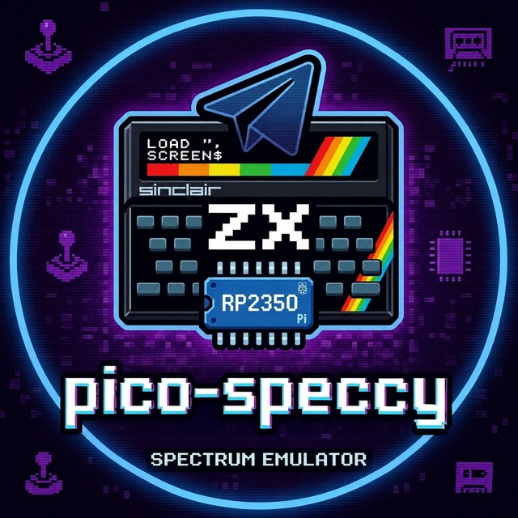

# Émulateurs 8 bits sur Waveshare RP2350

Ce dépôt regroupe mes développements ainsi qu'une sélection de projets compatibles permettant d'émuler des ordinateurs et consoles 8 bits sur la carte **Waveshare RP2350-PiZero** (microcontrôleur Raspberry Pi RP2350B).

---

## 📂 Structure du dépôt

| Dossier | Description |
| :--- | :--- |
| **[`RP2350_Brief`](./RP2350_Brief)** | Documentation, schémas de câblage et présentation technique de la carte Waveshare RP2350. |
| **[`commodore64`](./commodore64)** | Fichiers sources, firmwares et ressources pour l'émulation du **Commodore 64**. |
| **[`oric-atmos`](./oric-atmos)** | Fichiers sources, firmwares et ressources pour l'émulation de l'**Oric Atmos**. |
| **[`images`](./images)** | Captures d'écran et photos des réalisations matérielles. |

---

## 🖥️ Projets d'émulation (Dépôt local)

### 1. Commodore 64
Émulation du célèbre micro-ordinateur 8 bits de Commodore sur plateforme RP2350.
* Accéder au dossier : [`/commodore64`](./commodore64)

---

### 2. Oric Atmos
Émulation de l'Oric Atmos (processeur 6502) avec gestion de l'affichage et des périphériques.
* Accéder au dossier : [`/oric-atmos`](./oric-atmos)

---

## 🌐 Projets externes compatibles avec cette carte

Ce dépôt recense également d'autres émulateurs majeurs compatibles avec la carte **Waveshare RP2350-PiZero** :

### 3. ZX Spectrum (`pico-speccy`)
Émulateur complet des ordinateurs compatibles Sinclair ZX Spectrum (48K, 128K, +3, Pentagon, Scorpion, ZX Spectrum Next, etc.) avec support HDMI, audio I2S/PCM5122 et double port USB (PIO-USB).
* Dépôt officiel : [drewpo28/pico-speccy](https://github.com/drewpo28/pico-speccy/blob/main/README.md)

---

### 4. Nintendo NES (`pico-infonesPlus`)
Émulateur Nintendo Entertainment System (NES / Famicom Disk System) avec sortie HDMI, chargement depuis carte SD, menu OSD et support des manettes USB.
* Dépôt officiel : [PicoPlus-devel/pico-infonesPlus](https://github.com/PicoPlus-devel/pico-infonesPlus)

---

## 🛠️ Matériel requis & Modification PSRAM

* Carte de développement **Waveshare RP2350-PiZero** (voir détails dans [`RP2350_Brief`](./RP2350_Brief))
* **Ajout mémoire PSRAM (fortement recommandé) :**
  * La carte dispose d'un emplacement libre au dos (boîtier **SOP-8**) permettant de souder une puce **PSRAM APS6404L-3S** (capacité de **64 Mbit, soit 8 Mo**).
  * Cette extension de **8 Mo** est indispensable pour faire tourner les machines les plus gourmandes sous *pico-speccy* (ZX Spectrum Next, TS-Conf, etc.) et permet sous *pico-infonesPlus* de charger instantanément les ROMs en RAM sans avoir à les flasher.
  * *Note : Sur certaines cartes équipées d'une mémoire Flash non-Winbond (ex. Puya), un correctif logiciel unique (`FLASH_QE_SET_1.uf2`) peut être nécessaire pour activer le bit Quad Enable (QE) avant d'utiliser la PSRAM en overclocking.*
* Clavier ou manette USB (connecté sur le port PIO-USB de la carte)
* Carte microSD (formatée en FAT32 ou exFAT) pour le stockage des ROMs et images disques (`.d64`, `.tap`, `.tzx`, `.nes`, etc.)

---

## 🚀 Installation rapide (Flashage `.uf2`)
1. Téléchargez le fichier firmware `.uf2` correspondant à la carte **Waveshare RP2350-PiZero** depuis le dossier concerné ou la page *Releases* du projet.
2. Maintenez le bouton **BOOT** de la carte enfoncé tout en la raccordant à votre ordinateur via le port **USB** (et non PIO-USB).
3. Relâchez le bouton une fois que le lecteur amovible `RP2350` apparaît.
4. Glissez-déposez le fichier `.uf2` sur ce lecteur ; la carte redémarre automatiquement sur l'émulateur.

---

## 👤 Auteur
* **Anthony (F4GOH)** – [GitHub @f4goh](https://github.com)

