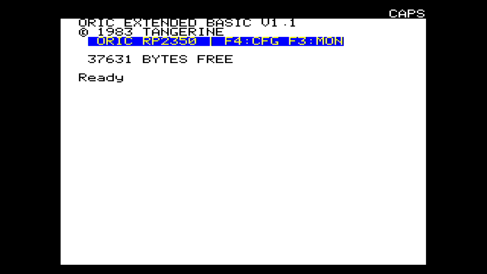
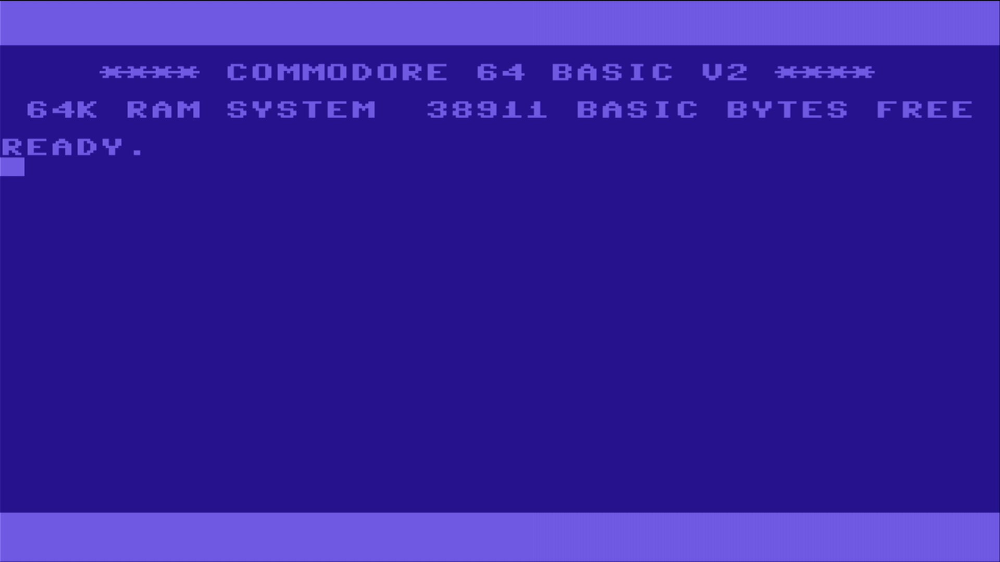
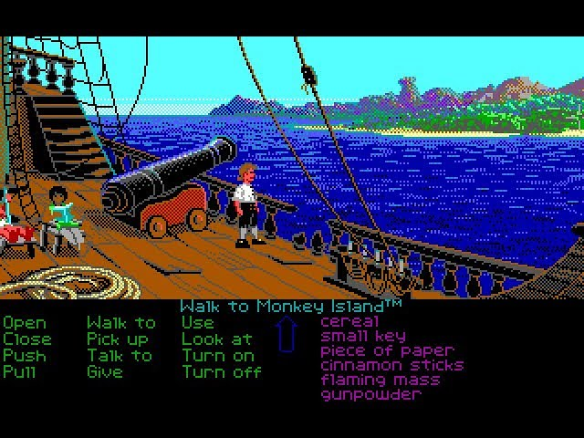
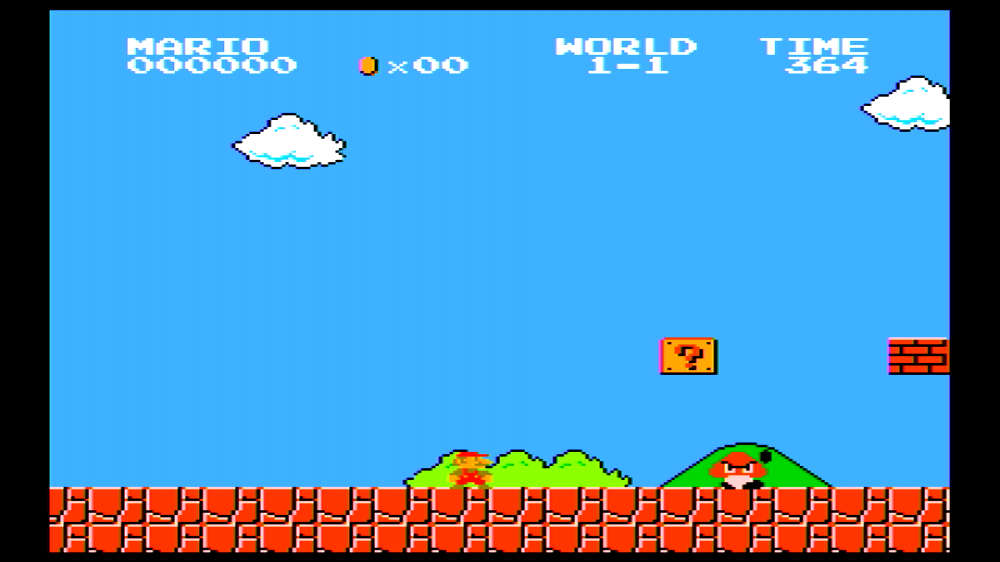

# Émulateurs 8 bits sur Waveshare RP2350

Ce dépôt regroupe mes développements ainsi qu'une sélection de projets compatibles permettant d'émuler des ordinateurs et consoles 8 bits sur la carte **Waveshare RP2350-PiZero** (microcontrôleur Raspberry Pi RP2350B). **Cette carte a été choisie avant tout pour son port mini-HDMI intégré permettant de sortir directement la vidéo (via PIO)**, offrant ainsi une solution compacte pour le rétrogaming.

---

## 📂 Structure du dépôt

* **[`RP2350_Brief`](./RP2350_Brief)** : Documentation, schémas de câblage et présentation technique de la carte Waveshare RP2350.
* **[`oric-atmos`](./oric-atmos)** : Fichiers sources, firmwares et ressources pour l'émulation de l'**Oric Atmos**.
* **[`commodore64`](./commodore64)** : Fichiers sources, firmwares et ressources pour l'émulation du **Commodore 64**.
* **[`apple2e`](./apple2e)** : Fichiers sources, firmwares et ressources pour l'émulation de l'**Apple IIe**.
* **[`scumm`](./scumm)** : Fichiers sources, firmwares et ressources pour l'émulation **ScummVM** ([voir `scumm/readme.md`](./scumm/readme.md)).
* **[`pico-speccy`](./pico-speccy)** : Guide complet, raccourcis clavier et configuration Wi-Fi ESP-01S pour le **ZX Spectrum** ([voir `pico-speccy/readme.md`](./pico-speccy/readme.md)).
* **[`pico-nes`](./pico-nes)** : Aide-mémoire des touches, manettes et câblage GPIO/I2S pour la **Nintendo NES** ([voir `pico-nes/readme.md`](./pico-nes/readme.md)).

---

## 🖥️ Projets d'émulation (Dépôt local)

### 1. Oric Atmos
Émulation de l'Oric Atmos (processeur 6502) avec gestion de l'affichage et des périphériques.
* Accéder au dossier : [`/oric-atmos`](./oric-atmos)

---

### 2. Commodore 64
Émulation du micro-ordinateur 8 bits de Commodore sur plateforme RP2350.
* Accéder au dossier : [`/commodore64`](./commodore64)
* Code adapté à partir de : [rh1tech/frank-c64](https://github.com/rh1tech/frank-c64)

---

### 3. Apple IIe
Émulation de l'Apple IIe (processeur 65C02) avec gestion des modes vidéo et images disques (`.dsk`, `.nib`, `.woz`).
* Accéder au dossier : [`/apple2e`](./apple2e)
* Code adapté à partir de : [rh1tech/frank-apple](https://github.com/rh1tech/frank-apple)

---

### 4. Jeux d'aventure Point & Click (`pico-scummvm` / ScummVM)
Émulation de jeux d'aventure classiques (LucasArts, Sierra, Revolution Software...) avec sortie HDMI, chargement depuis carte SD, menu OSD et support souris/clavier USB.
* Aide-mémoire local (touches AZERTY/QWERTY, configuration souris & répertoires de jeux) : [`pico-scummvm/readme.md`](./pico-scummvm/readme.md)
* Dépôt officiel : [PicoPlus-devel/pico-scummvm](https://github.com/adafruit/Adafruit_Arcade_Machines)

---

## 🌐 Projets externes compatibles (avec guides locaux)

Ce dépôt inclut également des guides complets d'installation et de câblage pour deux émulateurs majeurs compatibles avec la **Waveshare RP2350-PiZero** :

### 5. ZX Spectrum (`pico-speccy`)
Émulation complète de la famille Sinclair ZX Spectrum (48K, 128K, +3, Pentagon, Scorpion, ZX Spectrum Next, etc.) avec support HDMI, audio I2S/PCM5122, double port USB (`PIO-USB`) et réseau Wi-Fi.
* Guide local (installation, raccourcis, NextZXOS & Wi-Fi ESP-01S) : [`pico-speccy/readme.md`](./pico-speccy/readme.md)
* Dépôt officiel : [drewpo28/pico-speccy](https://github.com/drewpo28/pico-speccy)

---

### 6. Nintendo NES (`pico-infonesPlus`)
Émulation Nintendo Entertainment System (NES / Famicom Disk System) avec sortie HDMI, chargement depuis carte SD, menu OSD et support des manettes USB ou originales.
* Aide-mémoire local (touches AZERTY/QWERTY, manettes NES/SNES & audio I2S) : [`pico-nes/readme.md`](./pico-nes/readme.md)
* Dépôt officiel : [PicoPlus-devel/pico-infonesPlus](https://github.com/PicoPlus-devel/pico-infonesPlus)

---
## 🛠️ Matériel requis & Modification PSRAM

* **Carte de développement :** **Waveshare RP2350-PiZero** (voir détails dans [`RP2350_Brief`](./RP2350_Brief)).
  * *Note vidéo & audio :* Sur cette carte, le port mini-HDMI n'est pas routé sur les broches HSTX mais sur des GPIO standards pilotés en **PIO** (compatibilité broche à broche avec la RP2040-PiZero). L'audio passe par un DAC I2S externe (type **PCM5122** / **PCM5102A**) ou par sortie PWM sur le connecteur 40 broches selon le firmware.
* **Extension mémoire PSRAM (fortement recommandée) :**
  * Un emplacement libre au dos de la carte (boîtier **SOP-8**) permet de souder une puce **PSRAM APS6404L-3S** de **8 Mo (64 Mbit)**.
  * Indispensable pour *frank-c64*, *frank-apple* en mode complet et *pico-speccy* (ZX Spectrum Next, TS-Conf), et permet sous *pico-infonesPlus* un chargement instantané en RAM.
  * *Note Flash :* Sur les cartes dotées d'une mémoire Flash non-Winbond (ex. Puya), un flashage unique de `FLASH_QE_SET_1.uf2` active le bit Quad Enable (QE) nécessaire au fonctionnement stable de la PSRAM en overclocking.
* **Périphériques :** Clavier ou manette USB connecté sur le port **PIO-USB** (`J2`), et carte microSD formatée en **FAT32** pour les ROMs et images disques.

---

## 🚀 Installation rapide (Flashage `.uf2`)
1. Téléchargez le fichier `.uf2` adapté à la **Waveshare RP2350-PiZero** depuis le dossier du projet ou sa page *Releases*.
2. Maintenez le bouton **BOOT** enfoncé tout en reliant la carte au PC via le port **USB** principal (et non `PIO-USB`).
3. Relâchez le bouton dès l'apparition du lecteur amovible `RP2350`.
4. Copiez le fichier `.uf2` sur ce lecteur ; la carte redémarre aussitôt sur l'émulateur.

---

